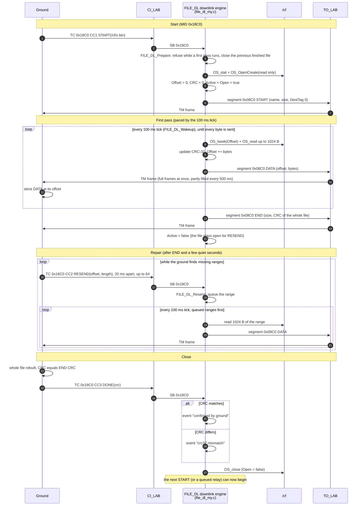
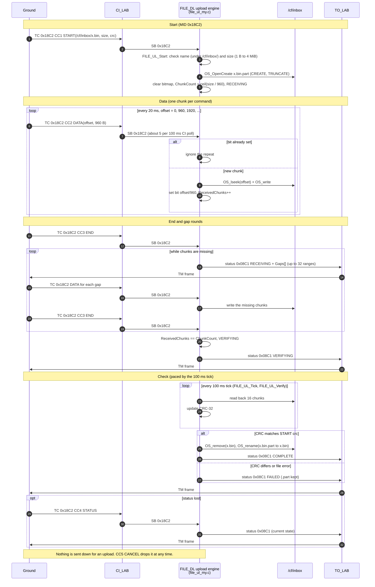
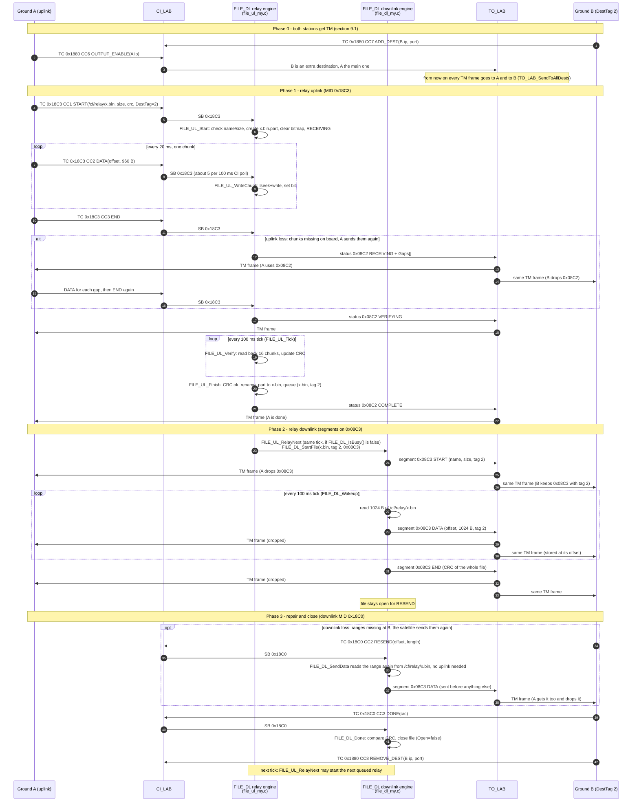

# FILE_DL — downlink, upload and relay of files

`file_dl` is one cFS app with three jobs. Each job has its own **command MID** and its own **function codes**.

| Job | Command MID | Telemetry MID | What happens |
|---|---|---|---|
| **Downlink** | `0x18C0` | `0x08C0` segments | A file on board is sent to the ground. |
| **Upload** | `0x18C2` | `0x08C1` status | The ground writes a file into `/cf/inbox/`. Nothing is sent down. |
| **Relay** | `0x18C3` | `0x08C2` status, `0x08C3` segments | The ground writes a file into `/cf/relay/`. After the CRC check, the satellite sends it down to the station named by `DestTag`. |

All three move data by **byte offset**. Every piece carries its own offset, so pieces may arrive in any order and only the missing ranges are sent again. A standard CRC-32 (IEEE, the one used by zip and PNG) checks the whole file at the end.

Commands come in through CI_LAB, and all telemetry goes out through TO_LAB.

```
                      0x18C0 DL    ─┐                                   ┌─ 0x08C0 DL segments
Ground ─TC─▶ CI_LAB ─SB─ 0x18C2 UL ─┼─▶ FILE_DL app ─────────────────────┼─ 0x08C1 UL status    ─SB─▶ TO_LAB ─TM─▶ Ground
                      0x18C3 RELAY ─┘   │ file_dl_my.c  downlink engine  ├─ 0x08C2 RELAY status             (A or B)
                                        │ file_ul_my.c  upload engine ×2 └─ 0x08C3 RELAY segments
                                        │               (upload, relay)
                                        ▼
                     /cf/...    /cf/inbox/<name>    /cf/relay/<name>
```

---

## 1. Message IDs

| MID | Dir | Macro (`file_dl_msgids.h`) | Used for |
|---|---|---|---|
| `0x18C0` | TC | `FILE_DL_CMD_MID` | Downlink commands (CC 0–3) |
| `0x18C1` | TC | `FILE_DL_WAKEUP_MID` | Optional: runs one downlink tick. The app has its own 100 ms clock, so nothing sends this now. |
| `0x18C2` | TC | `FILE_UL_CMD_MID` | Upload commands (CC 0–5) |
| `0x18C3` | TC | `FILE_RELAY_CMD_MID` | Relay commands (CC 0–5, same codes as upload) |
| `0x08C0` | TM | `FILE_DL_SEG_TLM_MID` | Downlink segments: START, DATA, END |
| `0x08C1` | TM | `FILE_UL_STATUS_TLM_MID` | Upload status: state, missing ranges, CRC |
| `0x08C2` | TM | `FILE_RELAY_STATUS_TLM_MID` | Relay upload status (same format as `0x08C1`) |
| `0x08C3` | TM | `FILE_RELAY_SEG_TLM_MID` | Relay downlink segments (same format as `0x08C0`) |

---

## 2. Command packets

### 2.1 Common header (8 bytes)

Every command starts with the cFS v1 command header. All multi-byte fields are **big-endian**.

| Byte | Field | Value |
|---|---|---|
| 0–1 | Stream ID | The command MID, e.g. `0x18 0xC0` |
| 2–3 | Sequence | `0xC0 0x00` (unsegmented) |
| 4–5 | Length | Total packet length − 7 |
| 6 | **Function code (CC)** | See the tables below |
| 7 | Checksum | XOR of all bytes, starting from `0xFF`. Neither CI_LAB nor FILE_DL checks it. |

The payload starts at **byte 8**. FILE_DL checks the total length of each command exactly. A wrong length gives the event `bad command cc N, size M`.

### 2.2 Downlink — MID `0x18C0`

| CC | Macro | Name | Payload (bytes from 8) | Total | Action | Reply |
|---|---|---|---|---|---|---|
| **0** | `FILE_DL_NOOP_CC` | NOOP | – | 8 | – | event `FILE_DL: NOOP` |
| **1** | `FILE_DL_START_CC` | START | `8–71 Filename[64]` (NUL-padded) | 72 | Opens the file and sends the START segment. Then one DATA every 100 ms, then END. | segments on `0x08C0` |
| **2** | `FILE_DL_RESEND_CC` | RESEND | `8–11 Offset[4]`, `12–15 Length[4]` | 16 | Queues the byte range (up to 64 ranges). It is sent before any new data. | DATA segments |
| **3** | `FILE_DL_DONE_CC` | DONE | `8–11 Crc32[4]` (of the rebuilt file) | 12 | Compares the CRC with the file's, then closes the file. | event `confirmed by ground` or `crc32 mismatch` |

RESEND and DONE also work for a relayed file, because the downlink engine sends relays too.

### 2.3 Upload — MID `0x18C2` / Relay — MID `0x18C3`

Both MIDs use the same function codes. Only START differs: relay START has a `DestTag`.

| CC | Macro | Name | Payload (bytes from 8) | Total | Action | Reply |
|---|---|---|---|---|---|---|
| **0** | `FILE_UL_NOOP_CC` | NOOP | – | 8 | – | event `FILE_UL: NOOP` / `FILE_RELAY: NOOP` |
| **1** | `FILE_UL_START_CC` | START (upload) | `8–71 Filename[64]`, `72–75 FileSize[4]`, `76–79 Crc32[4]` | **80** | Checks the name and size, creates `<name>.part`, clears the bitmap. State becomes RECEIVING. | event `receiving ...` |
| **1** | `FILE_UL_START_CC` | START (relay) | as upload, plus `80 DestTag`, `81–83 Spare[3]` | **84** | The same, and remembers `DestTag` for the relay downlink. | event `receiving ..., tag N` |
| **2** | `FILE_UL_DATA_CC` | DATA | `8–11 Offset[4]`, `12–13 DataLength[2]`, `14–15 Spare[2]`, `16– Data[DataLength]` | 16 + n (n ≤ 960) | Writes the chunk at its offset and sets its bit. A chunk that is already there is ignored. | – (an event only if rejected) |
| **3** | `FILE_UL_END_CC` | END | – | 8 | If chunks are missing: reports them. If not: starts the CRC check (VERIFYING). | status |
| **4** | `FILE_UL_STATUS_CC` | STATUS | – | 8 | Sends the status again, e.g. when the last one was lost. | status |
| **5** | `FILE_UL_CANCEL_CC` | CANCEL | – | 8 | Closes and removes `<name>.part`. State becomes IDLE. | event `cancelled`, then status |

**Rules checked by the satellite**
- The file name must be directly under the MID's own directory: `/cf/inbox/` for upload, `/cf/relay/` for relay. No `..` and no subdirectories.
- The size must be between 1 byte and 4 MiB (`FILE_UL_MAX_FILE_SIZE`).
- DATA:
  - `Offset` must be a multiple of 960 (`FILE_UL_CHUNK_SIZE`).
  - `DataLength` must be 960, except for the last chunk, which holds `FileSize − Offset` bytes.
  - The packet length must be `16 + DataLength`.
- A new START is refused while a transfer on the same MID is RECEIVING or VERIFYING.

---

## 3. Telemetry packets

Each telemetry packet starts with the 16-byte cFS telemetry header (section 3.4). The payload starts at **byte 16**.

### 3.1 Segment — `0x08C0` (downlink) and `0x08C3` (relay)

| Byte | Field | Meaning |
|---|---|---|
| 16 | `Type` | 0 START, 1 DATA, 2 END |
| 17 | `DestTag` | 0 for a downlink. For a relay, the tag from relay START. |
| 18–19 | `DataLength` | Bytes in `Data` |
| 20–23 | `Offset` | DATA: byte offset in the file. Otherwise 0, or the file size for END. |
| 24–27 | `FileSize` | File size. Every segment has it. |
| 28–31 | `Crc32` | END: CRC-32 of the whole file. Otherwise: CRC so far. |
| 32– | `Data` | START: the file name. DATA: up to 1024 file bytes. END: empty. |

### 3.2 Status — `0x08C1` (upload) and `0x08C2` (relay), 360 bytes

| Byte | Field | Meaning |
|---|---|---|
| 16 | `State` | 0 IDLE, 1 RECEIVING, 2 VERIFYING, 3 COMPLETE, 4 FAILED |
| 17 | `Relay` | 0 on `0x08C1`, 1 on `0x08C2` |
| 18 | `DestTag` | Tag from relay START (0 for upload) |
| 19 | `GapCount` | Gaps listed in this packet (≤ 32) |
| 20–23 | `FileSize` | From START |
| 24–27 | `ReceivedBytes` | Bytes received so far |
| 28–31 | `ExpectedCrc` | CRC-32 from START |
| 32–35 | `FileCrc` | CRC-32 of the stored file, read back (valid after VERIFYING) |
| 36–39 | `TotalGaps` | All missing ranges. This may be more than `GapCount`. |
| 40–103 | `Filename[64]` | File name |
| 104–359 | `Gaps[32]` | `Offset[4] Length[4]` for each missing byte range |

**When it is sent:** after END, after STATUS, after CANCEL, when the CRC check ends (COMPLETE or FAILED), and after a write error.

| State | Meaning | What the ground does |
|---|---|---|
| 0 IDLE | Nothing in progress | Sends START |
| 1 RECEIVING | Chunks are missing | Sends the chunks in `Gaps`, then END again |
| 2 VERIFYING | All chunks are here; the CRC check is running | Waits. The next status comes by itself. |
| 3 COMPLETE | The CRC matched and `.part` was renamed to `<name>` | Upload: done. Relay: waits for segments on `0x08C3`. |
| 4 FAILED | The CRC did not match, or a file error happened. `.part` is kept. | Sends CANCEL, or sends START again |

### 3.3 Event IDs

| EID | Text starts with | When |
|---|---|---|
| 1 | `FILE_DL Initialized` | App start |
| 2 | `FILE_DL: ... rejected / bad command / still being sent` | Wrong downlink command |
| 3 | `FILE_DL: sending <name>, N bytes` | Downlink starts |
| 4 | `FILE_DL: cannot open / read error` | File error |
| 5 | `FILE_DL: <name> sent, crc32 ...` | First pass done (END sent) |
| 6 | `FILE_DL: NOOP` | NOOP |
| 7 / 8 | `confirmed by ground` / `crc32 mismatch` | DONE |
| 9 | `FILE_UL/FILE_RELAY: receiving ...`, `NOOP` | START, NOOP |
| 10 | `... rejected`, `bad command`, `still being received`, `queue full` | Wrong upload or relay command |
| 11 | `cannot create / write error / read error / cannot rename` | File error |
| 12 | `<name> received and verified` | COMPLETE |
| 13 | `crc32 mismatch` | FAILED |
| 14 | `FILE_RELAY: sending <name> to tag N` | Relay downlink starts |
| 15 | `<name> cancelled` | CANCEL |

### 3.4 Space Packet header and segment header

These are two different headers, and they are stacked. The **Space Packet (SPP) header** is the CCSDS standard header at the start of every packet. The **segment header** is defined by file_dl. It sits inside the user data of that packet.

```
┌──────────── TM Transfer Frame, 1786 B (TO_LAB, TM-SDLP) ─────────────────────────────┐
│ Frame hdr 6 B │ SDLS area 14 B (zero) │ data field 1766 B: Space Packets, idle fill    │
└───────────────┴───────────────────────┼────────────────────────────────────────────────┘
                                        ▼
┌──────────────────────────── one Space Packet (0x08C3 relay segment) ───────────────────┐
│ ① Primary 6 B │ ② Secondary 6 B │ ③ Spare 4 B │ ④ Segment header 16 B │ Data ≤ 1024 B │
│ CCSDS SPP     │ cFS: time       │ cFS: align  │ file_dl               │ file bytes    │
├───────────────┴─────────────────┴─────────────┼───────────────────────┴───────────────┤
│ cFS TLM header = 16 B (bytes 0–15)             │ user data for the SPP (bytes 16– )    │
└────────────────────────────────────────────────┴───────────────────────────────────────┘
```

| Part | Size | Defined by | Contents | Source |
|---|---|---|---|---|
| ① SPP primary header | 6 B | **CCSDS 133.0-B** | Version, type (TLM/CMD), secondary header flag, APID, sequence flags and count, packet length | `cfe/modules/msg/fsw/inc/ccsds_hdr.h` |
| ② Secondary header | 6 B | cFS | Time | `cfe/modules/msg/option_inc/default_cfe_msg_hdr_pri.h` |
| ③ Spare | 4 B | cFS | Padding for 64-bit alignment | same file |
| ④ Segment header | 16 B | **file_dl** | Type, DestTag, DataLength, Offset, FileSize, Crc32 (section 3.1) | `fsw/src/file_dl_my.h` (`FILE_DL_SegHdr_t`) |

Each header answers a different question:

- **The SPP header says what the packet is and where it ends.** The APID (the cFS MID, here `0x08C3`) names the application. The packet length marks where the packet ends. TO_LAB uses it to put packets into frames, and the ground deframer uses it to cut them out again. The SPP header has nothing about files.
- **The segment header says where in the file the piece belongs.** It holds the piece type, the file offset, the file size, the CRC and the station tag. Neither SPP nor TO_LAB reads it. Only file_dl and the ground client do.

There are two levels of splitting:

| Level | Done by | Unit | How a piece is placed |
|---|---|---|---|
| File → segments | file_dl | ≤ 1024 B of file data | `Offset` in the segment header |
| Packets → frames | TO_LAB (TM-SDLP) | 1786 B frame | First Header Pointer in the frame header, plus the SPP packet length |

A full segment packet is 1056 B. It is smaller than the 1766 B data field, so it is never split at the SPP level. It can still run over the end of one frame into the next frame. The First Header Pointer (FHP) joins the two parts.

#### Is `DestTag` a CCSDS field?

No. It was chosen for this app.

- It uses byte 17, the second byte of the file_dl segment header. That byte used to be `Spare`.
- No standard header in this path has a destination station:
  - SPP: APID names an application process.
  - TM frame: SCID and VCID name the spacecraft and the virtual channel.
- The closest CCSDS concept is the Destination Entity ID in the CFDP PDU header (CCSDS 727.0-B). file_dl does not use CFDP.

`DestTag` is carried in three places:

| Where | Packet | Position |
|---|---|---|
| Up | Relay START command (`0x18C3` CC 1) | Byte 80, after Filename[64], FileSize[4] and Crc32[4] |
| Down | Each relay segment (`0x08C3`) | Byte 17 (segment header byte 1) |
| Down | Relay status (`0x08C2`) | Byte 18 |

The satellite does **not** route by `DestTag`. TO_LAB sends every frame to every destination (section 9). Each ground station keeps the segments with its own tag. Any station can still read the others' files, because SDLS encryption is off.

---

## 4. How it works, end to end

### 4.1 Start-up

At start-up, `FILE_DL_AppMain` does the following once:
1. Creates the pipe `FILE_DL_PIPE` (depth 32).
2. Subscribes to `0x18C0`, `0x18C2` and `0x18C3`, each with a message limit of 32, and to `0x18C1`.
3. Calls `FILE_UL_Init`, which prepares two instances of the upload engine (`FILE_UL_Ctx_t`):
   - upload: `/cf/inbox`, status on `0x08C1`
   - relay: `/cf/relay`, status on `0x08C2`, relay flag on

   It also creates both directories.
4. Sends the event `FILE_DL Initialized`.

### 4.2 Main loop: one task, a 100 ms tick and commands in between

```
loop:
  now = CFE_PSP_GetTime()
  if now - lastTick >= 100 ms:            ── tick ──
      FILE_DL_Wakeup()                    downlink: one segment
      FILE_UL_Tick()                      upload + relay: CRC check steps, start a queued relay
      lastTick = now
  CFE_SB_ReceiveBuffer(pipe, time left until the next tick)
  dispatch by MID:
      0x18C0 → FILE_DL_ProcessCommand     (CC 0–3)
      0x18C2 → FILE_UL_ProcessCommand     → FILE_UL_Dispatch(upload instance)
      0x18C3 → FILE_RELAY_ProcessCommand  → FILE_UL_Dispatch(relay instance)
      0x18C1 → FILE_DL_Wakeup
```

Section 5 explains the tick and how this loop works together with the CI_LAB and TO_LAB loops.

### 4.3 Path of a command and of a segment

```
Ground ──UDP TC frame──▶ CI_LAB: OS_SocketRecvFrom → TC_SDLP_myExtractPacket → CFE_SB_TransmitBuffer
                                                                                     │ SB (MID 0x18Cx)
                                                                                     ▼
                                                                            FILE_DL_PIPE → FILE_DL
FILE_DL: FILE_DL_NewSegment / FILE_UL_SendStatus → CFE_SB_TransmitBuffer / TransmitMsg │ SB (MID 0x08Cx)
                                                                                     ▼
TO_LAB (every 100 ms): ReceiveBuffer(POLL) → TM_SDLP_myAddPacketToFrame → TM_SDLP_myFillAndSendFrame → TO_LAB_SendToAllDests
                                                                                     │ UDP TM frame (1786 B)
                                                                                     ▼
Ground A, B: deframe (First Header Pointer) → packets by MID
```

### 4.4 Downlink (`0x18C0`)

| Step | Ground sends | Satellite (function) | Comes down |
|---|---|---|---|
| 1 | `0x18C0` CC 1 START(`/cf/x.bin`) | `FILE_DL_Start` → `FILE_DL_StartFile(name, tag 0, 0x08C0)`<br>→ `FILE_DL_Prepare`: refuses while a first pass is running; closes the previous finished file<br>→ `FILE_DL_OpenAndAnnounce`: `OS_stat`, `OS_OpenCreate` read-only, Active = Open = true | START segment (name, size) |
| 2 | – | Each tick, `FILE_DL_Wakeup` → `FILE_DL_SendData(Offset, …, firstPass)`<br>`OS_lseek` + `OS_read` up to 1024 B → `FILE_DL_NewSegment` (DestTag, SegMid) → `FILE_DL_Send`. The CRC is updated as it goes. | DATA segment, one per 100 ms |
| 3 | – | After the last byte: an END segment with the full CRC. Active = false. **The file stays open** for RESEND. | END segment |
| 4 | Ground rebuilds by `Offset` and finds the gaps.<br>`0x18C0` CC 2 RESEND(off, len) for each gap | `FILE_DL_Resend` queues the range (up to 64). Each tick, `FILE_DL_Wakeup` sends the queued ranges first. | DATA segments again |
| 5 | When nothing is missing: `0x18C0` CC 3 DONE(crc) | `FILE_DL_Done` compares the CRC, sends an event, then `FILE_DL_Close` (Open = false) | – |

**Sequence diagram of the downlink**



### 4.5 Upload (`0x18C2`)

| Step | Ground sends | Satellite (function) | Comes down |
|---|---|---|---|
| 1 | `0x18C2` CC 1 START(`/cf/inbox/x.bin`, size, crc) | `FILE_UL_Dispatch` → `FILE_UL_Start`<br>`FILE_UL_IsValidName`, size check → `OS_OpenCreate(x.bin.part, CREATE\|TRUNCATE)`<br>Clears the bitmap, ChunkCount = ⌈size / 960⌉, State = RECEIVING | event |
| 2 | `0x18C2` CC 2 DATA(off, bytes), one every 20 ms | `FILE_UL_WriteChunk`: checks the chunk, ignores a repeat, then `OS_lseek` + `OS_write`, sets bit `off/960`, ReceivedChunks++ | – |
| 3 | `0x18C2` CC 3 END | `FILE_UL_End`: if ReceivedChunks == ChunkCount, State = VERIFYING. Then `FILE_UL_SendStatus` turns each run of 0 bits into one entry in `Gaps`. | status `0x08C1` |
| 4 | If RECEIVING: the DATA chunks listed in `Gaps`, then END again | Same as steps 2–3 | status |
| 5 | – | Each tick, `FILE_UL_Tick` → `FILE_UL_Verify` reads back 16 chunks and updates the CRC | – |
| 6 | – | After the last chunk, `FILE_UL_Finish`:<br>if the CRC matches: `OS_remove(x.bin)`, `OS_rename(x.bin.part → x.bin)`, COMPLETE<br>if not: FAILED | status COMPLETE or FAILED |

Nothing is sent down for an upload. To get the file back, send a downlink START.

**Sequence diagram of the upload**



### 4.6 Relay (`0x18C3`): uplink, then downlink

The relay START puts the relay instance in RECEIVING, so every following `0x18C3` DATA is treated as uplink. When the file is complete and checked, the satellite sends it down without another command.

| Step | Ground sends | Satellite (function) | Comes down |
|---|---|---|---|
| 1 | `0x18C3` CC 1 START(`/cf/relay/x.bin`, size, crc, **DestTag=2**) | `FILE_UL_Dispatch(relay instance)` → `FILE_UL_Start` (as for upload, plus DestTag) | event |
| 2–6 | `0x18C3` DATA ×N, END, and gap rounds | Same as upload steps 2–6, but status on `0x08C2` and files in `/cf/relay/` | status `0x08C2` |
| 7 | – | `FILE_UL_Finish` on COMPLETE: puts (name, tag) into the relay queue (4 entries) | status COMPLETE |
| 8 | – | In the same tick, `FILE_UL_RelayNext`: if `FILE_DL_IsBusy()` is false (no first pass running; a file waiting for DONE is closed),<br>`FILE_DL_StartFile(name, tag 2, 0x08C3)` | START segment on **`0x08C3`**, DestTag=2 |
| 9 | – | Downlink steps 2–3, with every segment on `0x08C3` carrying DestTag=2 | DATA ×N, END on `0x08C3` |
| 10 | Station B keeps only `0x08C3` segments with tag 2 and finds its gaps. B itself sends **`0x18C0`** CC 2 RESEND, then CC 3 DONE. | Downlink steps 4–5 | DATA again |
| 11 | – | `FILE_DL_Close` makes Open false, so on the next tick `FILE_UL_RelayNext` can start the next queued relay | – |

**Sequence diagram of the relay**



Each station receives every TM frame and keeps only its own packets: A uses `0x08C2`, and B uses `0x08C3` with tag 2. Lost data is sent again by whoever still has it:

| Loss on | Found by | Asked for with | Sent again by | Diagram |
|---|---|---|---|---|
| Uplink, A → satellite | Satellite (chunk bitmap) | `Gaps[]` in status `0x08C2` | **A** | Phase 1 `alt` |
| Downlink, satellite → B | B (empty offsets) | B's `0x18C0` RESEND | **Satellite**, from `/cf/relay/x.bin` | Phase 3 `opt` |

A never uploads again because of a RESEND. The downlink only starts after the whole file is on board and its CRC is checked.

### 4.7 What can run at the same time

| Combination | Possible? |
|---|---|
| Upload and relay uplink | Yes. Each has its own instance and bitmap. |
| Uplink (upload or relay) while a downlink is running | Yes. The downlink keeps its 10 segments/s. |
| Two downlinks (downlink START and a relay downlink) | No, one at a time. During a first pass, a relay waits in the queue and a downlink START is refused. After END, either one closes the file that waits for DONE. |

---

## 5. Tick and loops: how timing links uplink and downlink

### 5.1 What a tick is, and what waiting in ReceiveBuffer means

**A tick is the name for "the fixed work done once every 100 ms"** (the `if` in section 4.2). It is not an OS feature, just one variable and one comparison.

FILE_DL has two kinds of work:

| Kind | When it comes | Example |
|---|---|---|
| **Periodic work** | Must go on although nobody asks | Send a file down, 1 KiB per 100 ms |
| **Commands** | Whenever the ground sends one, at any time | START, DATA, RESEND, DONE |

The tick is when the periodic work runs.

**The problem:** FILE_DL is one task, so it does one thing at a time. When it has nothing to do, it must **sleep**, so that CI, TO and the other apps get the CPU. So the task needs this:

> "Wake me as soon as a command arrives. If none arrives, wake me when the next periodic work is due."

**`CFE_SB_ReceiveBuffer(pipe, wait)` is a sleep with two wake-up conditions:**

```
CFE_SB_ReceiveBuffer(&pBuf, pipe, 70)
   ├─ a command enters the pipe within 70 ms → wakes at that moment (CFE_SUCCESS, command returned)
   └─ nothing arrives for 70 ms              → wakes after 70 ms   (CFE_SB_TIME_OUT, nothing returned)
```

Passing **the time left until the next tick** as `wait` makes the task wake at whichever comes first: a command, or the next tick. It wakes only when needed and sleeps the rest of the time.

**Example:** commands arrive at 30 ms and 60 ms.

```
time   what happens                                         next wait
  0    tick (one segment sent), lastTick = 0                100 - 0  = 100 ms
       → sleep (up to 100 ms)
 30    command arrives → wakes at once, handles it
       clock: 30 ms since the tick                          100 - 30 = 70 ms
       → sleep (up to 70 ms)
 60    command arrives → wakes at once, handles it
       clock: 60 ms since the tick                          100 - 60 = 40 ms
       → sleep (up to 40 ms)
100    40 ms pass with no command → wakes on the timeout
       clock: 100 ms → tick, lastTick = 100                 100 ms
```

- Commands are handled **the moment they arrive** (30, 60).
- The tick runs **every 100 ms exactly** (0, 100, 200 …), however many commands come.
- In between, the task sleeps and uses no CPU.

**Why other ways do not work**

| Way | Result |
|---|---|
| `ReceiveBuffer(pipe, PEND_FOREVER)` | With no command the task sleeps forever, so **the file is never sent**. |
| `OS_TaskDelay(100)`, then poll the pipe (as TO_LAB does) | A command waits up to 100 ms, and commands pile up in the pipe and may overflow it. |
| `ReceiveBuffer(pipe, 100)` always, with the tick only on a timeout (**earlier version**) | Each command restarts the 100 ms. With a command every 20 ms the wait never times out, so **the tick never runs and the downlink stops**. |
| Never sleep, keep reading the clock (busy loop) | Uses 100% CPU, so lower-priority apps never run. |
| **`ReceiveBuffer(pipe, time left)` (now)** | Commands at once, the tick every 100 ms, sleep the rest of the time. |

The earlier and current versions differ only in the wait they pass:

```
earlier: always 100 ms          → each command sets the alarm 100 ms later again
now:     100 ms - time passed   → the alarm stays fixed at the next tick
```

**Analogy:** someone must post a letter at fixed times (the tick) and open the door when the bell rings (a command).
- **Now:** they set the alarm for the next posting time and sleep. When the bell wakes them, they answer the door, leave the alarm as it is, and go back to sleep.
- **Earlier:** each time the bell woke them, they set the alarm to "100 ms from now". With visitors coming all the time, the alarm never went off and no letter was posted.

### 5.2 Three loops and two queues

Between the ground and FILE_DL there are **three loops**, each a separate task with its own clock. **SB pipes** (queues) connect them.

```
Ground ─UDP─▶ [CI_LAB loop] ─SB─▶ FILE_DL_PIPE ─▶ [FILE_DL loop] ─SB─▶ TO_LAB_TLM_PIPE ─▶ [TO_LAB loop] ─UDP─▶ Ground
              socket every 100 ms     (queue)     100 ms tick + commands     (queue)       empty pipe every 100 ms
```

| Loop | Wakes up when | Does | Setting |
|---|---|---|---|
| CI_LAB | A command arrives for CI, or 100 ms pass | Reads up to 11 TC frames from the UDP socket and sends each packet to the SB | `CI_LAB_UPLINK_POLL_MSEC` 100 |
| **FILE_DL** | A command arrives, or the **next tick is due** | Every tick: one downlink segment, CRC check steps, start of a relay. Commands are handled as they arrive. | `FILE_DL_SEND_PERIOD_MSEC` 100 |
| TO_LAB | Every 100 ms (`OS_TaskDelay`) | Empties its telemetry pipe into TM frames and sends them | `TO_TASK_MSEC` 100 |

- The loops never wait for each other.
- What one loop hands to the next waits in an SB pipe.
- The OS scheduler decides which task runs when. On native Linux, task priorities are ignored unless the app runs as root.

### 5.3 Why commands never push the tick back

- After each command, the loop reads the clock again. If 100 ms have passed, the tick runs before the next command.
- The wait in `ReceiveBuffer` is always the time *left*, not a fresh 100 ms.

```
time (ms)   0      20     40     60     80     100    120
command     ▼      ▼      ▼      ▼      ▼      ▼      ▼        (upload DATA every 20 ms)
wait        100    80     60     40     20     –      80
tick        ●                                  ●               (every 100 ms exactly)
```

- A tick can be late only by the time one command takes to handle, which is a few milliseconds.

### 5.4 What runs in a tick

**`FILE_DL_Wakeup` (downlink)** sends `FILE_DL_SEGMENTS_PER_TICK` (1) segment per tick. It picks the segment in this order:

1. A queued RESEND range: the next 1024 bytes of it.
2. Otherwise, if the first pass is already done: nothing.
3. Otherwise, the next 1024 bytes of the file, and the CRC is updated.
4. When every byte has been sent: the END segment, and the first pass ends.

So **the tick sets the downlink rate**: 1024 B per 100 ms, about 10 KiB/s.

**`FILE_UL_Tick` (upload and relay)**
1. `FILE_UL_Verify(upload)`: if the upload is VERIFYING, it reads 16 chunks (about 15 KB) back from storage and adds them to the CRC.
2. `FILE_UL_Verify(relay)`: the same for the relay file.
3. `FILE_UL_RelayNext`: if a verified relay file is waiting and no downlink file is open, the relay downlink starts.

- Chunks are **written when DATA arrives** (command work), not in the tick. The tick only handles the check after reception ends.
- The CRC check is split across ticks. Reading 4 MiB at once would block the loop: the pipe could overflow and the downlink tick would slip.

### 5.5 Link to the downlink

```
FILE_DL tick ──1 segment──▶ TO_LAB_TLM_PIPE ──(TO empties it every 100 ms)──▶ TM frame 1786 B ──UDP──▶ Ground
```

1. Each tick, `FILE_DL_Send` puts one segment (up to 1056 B) into TO_LAB's telemetry pipe.
2. Every 100 ms TO_LAB takes packets until the pipe is empty and calls `TM_SDLP_myAddPacketToFrame` for each one.
   - A frame whose data field (1766 B) is full is sent **at once**.
   - The rest of the packet goes to the overflow queue and starts the next frame. This is packet segmentation, marked by the First Header Pointer.
3. A partly filled frame is padded with an idle packet and sent every `TO_LAB_FLUSH_CYCLES` (5) cycles, which is every 500 ms.

**Why both loops use 100 ms**
- FILE_DL adds one segment per 100 ms, and TO_LAB empties its pipe once per 100 ms. So usually at most one file segment waits in TO's pipe.
- Native Linux trims an SB pipe to 10 messages. An earlier version sent 8 segments at once on a 1 Hz wakeup; together with HK packets, that made `Pipe Overflow`.

**Delay**
- The two loops have the same period but are not in phase.
- A segment waits up to 100 ms for TO_LAB to wake up. In a partly filled frame it may wait up to 500 ms more.
- Two segments (2112 B) are more than one frame, so most frames go out within one or two ticks:

```
FILE_DL tick:  ●seg0           ●seg1           ●seg2 ...
TO_LAB wake:       ◆               ◆               ◆
                   seg0 into frame  seg1 added → over 1766 B
                   (not full yet)   → frame 1 sent, the rest starts frame 2
```

### 5.6 Link to the uplink

```
Ground ─TC every 20 ms─▶ UDP socket ─(CI: up to 11 frames every 100 ms)─▶ FILE_DL_PIPE ─(at once)─▶ FILE_DL command work
```

1. The ground sends a DATA command every 20 ms. The frames wait in the OS socket buffer.
2. CI_LAB wakes every 100 ms, reads up to 11 frames, and sends them to the SB. So about **5 commands arrive at FILE_DL together** every 100 ms.
3. FILE_DL wakes as soon as they are in its pipe and handles them one after another. If the tick becomes due in between, the tick runs first.

**What sets the upload rate**
- The **ground's spacing** sets it, not the tick, because writing chunks is command work.
- With 960 B every 20 ms, the limit is about 47 KiB/s. About 31 KiB/s was measured, because of per-command overhead and the waits for status after END.
- Sending faster than every 20 ms puts more commands into each CI batch. That can overflow FILE_DL's pipe (10 messages on native) or the limit of 32 messages per MID, which shows up as `Msg Limit Err`.
- A command reaches FILE_DL within about 100 ms (the CI poll) plus its handling time.

**The check after reception is paced by the tick**

```
END (command) → VERIFYING → 16 chunks of CRC per tick → … → last tick: COMPLETE, status sent
```

For 1 MiB (1,093 chunks), that is about 69 ticks, or about 7 s.

### 5.7 Upload and downlink at the same time

```
time (ms)   0     20    40    60    80    100   120   140   160   180   200
CI wake     ◇                             ◇                             ◇
pipe gets   ▮▮▮▮▮                         ▮▮▮▮▮                         ▮▮▮▮▮
FILE_DL     [5 commands]                  [5 commands]                  [5 commands]
tick        ●                             ●                             ●
              └ 1 DL segment ─▶ TO pipe     └ 1 segment                   └ 1 segment
TO wake        ◆                             ◆                             ◆
```

- Upload commands arrive in batches at CI's pace and are handled at once.
- Downlink segments leave once per tick, by the clock.
- Measured (`--mode both`, 256 KiB, 5% loss each way): 65 downlink segments came down during an 8.0 s upload. The ideal number is 80.

### 5.8 Settings

| Setting | Where | Raising it |
|---|---|---|
| `FILE_DL_SEGMENTS_PER_TICK` (1) | `file_dl_my.h` | Faster downlink, but TO's pipe may overflow |
| `FILE_DL_SEND_PERIOD_MSEC` (100) | `file_dl_my.h` | Slower ticks, so slower downlink and slower checks |
| `FILE_UL_VERIFY_CHUNKS` (16) | `file_ul_my.h` | Faster check, but each tick takes longer |
| Ground command spacing (20 ms) | `CMD_GAP` in `file_xfer_test.py` | Lowering it makes uploads faster, but risks pipe overflow and the MID message limit |

---

## 6. Timing and limits

| Item | Value |
|---|---|
| Tick | 100 ms (`FILE_DL_SEND_PERIOD_MSEC`) |
| Downlink rate | 1 segment of 1024 B per tick, about 10 KiB/s |
| Upload chunk | 960 B (`FILE_UL_CHUNK_SIZE`). One DATA command (976 B) fits one 1024-byte TC frame. |
| Upload rate (measured) | About 31 KiB/s, with one DATA every 20 ms |
| CRC check | 16 chunks per tick, about 150 KiB/s |
| File size | 4 MiB (upload and relay) |
| RESEND queue | 64 ranges |
| Relay queue | 4 files |
| Status gap list | 32 ranges per packet |

- On RTEMS, it has not been checked whether `/cf` (`/nonvol`) allows writing and renaming.

## 7. Files

| File | Content |
|---|---|
| `fsw/platform_inc/file_dl_msgids.h` | Message IDs |
| `fsw/src/file_dl_my.c/.h` | `FILE_DL_AppMain` (main loop, dispatch by MID), downlink engine, downlink commands, shared helpers (`FILE_DL_Crc32`, big-endian get/put, `FILE_DL_StartFile`, `FILE_DL_IsBusy`) |
| `diagrams/*.mmd` | The downlink, upload and relay sequence diagrams of section 4 |
| `fsw/src/file_ul_my.c/.h` | Upload engine with two instances (upload, relay): commands, chunk bitmap, `.part`, CRC read-back, rename, relay queue |
| `*.bak` | Earlier versions |

## 8. Tests (native)

All tests live in `file_dl_test/`.

```bash
python3 file_dl_test/file_xfer_test.py --mode relay --size 1048576 --ul-loss 0.05 --dl-loss 0.05
```

| Mode | Checks |
|---|---|
| `dl` | Downlink START, RESEND and DONE |
| `ul` | Upload, gap rounds, the CRC read back, the rename, and that nothing is sent down |
| `relay` | Relay uplink, then station 2 rebuilds the file from the `0x08C3` segments |
| `both` | Upload while another file is downlinked. The downlink must keep going. |
| `reject` | DATA without START, wrong directories, a file over 4 MiB, the wrong START size, a wrong CRC (FAILED, no relay), and CANCEL |

`--ul-loss` drops DATA commands on purpose, and `--dl-loss` drops TM frames. `file_dl_ground_test.py` is the original downlink-only test.

Your own files:

| Option | Mode | Effect |
|---|---|---|
| `--dl-file /cf/<name>` | `dl` | Downlinks a file you put in `build-native/exe/cpu1/cf/`. The file is kept, and the copy received is saved in `file_dl_test/received/`. |
| `--ul-file <path>` | `ul`, `relay` | Uploads a ground file to `/cf/inbox/<name>` (or `/cf/relay/<name>`) and keeps it there. |

OSAL limits a file name to 19 characters (`OS_MAX_FILE_NAME` 20). An uploaded file is written as `<name>.part` first, so its name can be at most 14 characters.

Two separate ground stations (section 9): `relay_ground_b.py` and `relay_ground_a.py`.

## 9. Ground clients: TO_LAB destinations and the relay

This section is for anyone who writes a ground client. A relay involves two ground stations, and **everything goes through the satellite**. The stations never talk to each other.

- **Ground A**, the uplink station, sends the file with the relay commands.
- **Ground B**, the downlink station, gets it from the satellite and asks the satellite for the missing parts.

```
A ──TC: relay START / DATA / END (0x18C3)──▶  satellite  ◀──TC: RESEND / DONE (0x18C0)── B
A ◀──────────── the same TM frames ─────────  satellite  ───────── the same TM frames ──▶ B
   A uses 0x08C2 (relay status)                         B uses 0x08C3 with its DestTag
```

### 9.1 TO_LAB: one main destination and extra destinations

TO_LAB builds each TM frame once. It sends the frame to the **main destination** and then sends the same frame to every **extra destination**. This acts like one RF downlink that every station in view receives. TO_LAB does not look inside the frames.

| CC | Command (MID `0x1880`) | Payload | Total size | Effect |
|---|---|---|---|---|
| 6 | `OUTPUT_ENABLE` | `dest_IP[16]` (text, NUL padded) | 24 B | Starts TM output, or moves it to a new main destination. The port is fixed to **1235**. |
| 7 | `ADD_DEST` | `DestIp[16]` + `Port[2]` (big-endian) | 26 B | Adds an extra destination, up to 4. Adding one that is already there changes nothing. |
| 8 | `REMOVE_DEST` | same as CC 7 | 26 B | Removes an extra destination. |

- No TM goes out at all until some station has sent `OUTPUT_ENABLE`. An extra destination only gets frames after that.
- If the send to the main destination fails, TO_LAB stops all output. A failed send to an extra destination is ignored.
- Events: 3 `TO telemetry output enabled for IP ...`, 22 `TO: TM also goes to ip:port` / `TO: TM no longer goes to ip:port`, 23 wrong size or no free slot.
- Code:
  - `apps/to_lab/fsw/src/to_lab_dest_my.c/.h`
  - one call in `tm_sdlp_my.c` (`TO_LAB_SendToAllDests` instead of `OS_SocketSendTo`)
  - two `case` lines in `to_lab_app.c`

### 9.2 What a client must do

**Sending a command (both stations)**

- Put each command in one TC frame to CI_LAB, UDP **1234**:
  - The 5-byte frame header is `0x20 0x03` (bypass flag, SCID 3), then VCID 0 and the 10-bit frame length − 1 in two bytes, then a sequence byte.
  - Then comes the 8-byte cFS command header (section 2.1), then the payload.
- Leave about **20 ms** between commands (section 5.6).
- COP-1 is not used, so two stations may send with their own sequence bytes.

**Receiving TM (both stations)**

1. Receive 1786-byte UDP frames on your port.
2. The Master Channel Frame Count is frame byte 2. If it jumps, drop any packet you were joining.
3. The First Header Pointer (FHP) is the low 11 bits of bytes 4–5. `0x7FF` means no packet starts in this frame.
4. The data field starts at byte 20 (6 B frame header + 14 B zeroed SDLS area). Cut it into packets with the SPP length: total length = bytes 4–5 + 7.
5. APID `0x7FF` is idle fill. Drop it.
6. The MID is the first two bytes of the packet. The payload starts at byte 16.

`to_test/tm_deframer.py` does steps 1–5.

### 9.3 Relay order for the two stations

1. B sends `ADD_DEST` (own IP and port, e.g. 1245). TO_LAB sends event 22.
2. A sends `OUTPUT_ENABLE` (own IP). TM now reaches A on 1235 and B on its port.
3. Relay steps 1–11 of section 4.6: A does the uplink (steps 1–6), and B does the repair and DONE (step 10).
4. B sends `REMOVE_DEST`. TO_LAB sends event 22.

Rules for each station:

- **Station A**
  - Ask with `STATUS` (CC 4) when a status does not come.
  - While the status is VERIFYING, wait for the next status.
  - Stop after COMPLETE. FAILED means the CRC did not match: the `.part` file is kept, and no downlink happens.
- **Station B**
  - Keep only `0x08C3` segments with your `DestTag`.
  - After END, and a few quiet seconds, send `RESEND` for the missing ranges.
  - When the file is whole and its CRC equals the END CRC, send `DONE`.
  - Until B sends `DONE`, the file stays open for RESEND. The next relay file or downlink START closes it, so send RESEND soon after END.

### 9.4 Running the two clients

| Receiver | UDP port | Sender |
|---|---|---|
| cFS (CI_LAB) | 1234 | A and B (commands) |
| A | 1235 | TO_LAB (main destination) |
| B | 1245 (`--tm-port`) | TO_LAB (extra destination) |

Run each in its own terminal, starting B before A:

```bash
cd build-native/exe/cpu1 && ./core-cpu1 -R PO
```

```bash
python3 file_dl_test/relay_ground_b.py --dl-loss 0.05
```

```bash
python3 file_dl_test/relay_ground_a.py nasa2.jpg --ul-loss 0.05
```

- For other hosts, give both clients `--host <cFS IP> --my-ip <own IP>`.
- B saves the file in `file_dl_test/received/`.
- On WSL2 with NAT, other hosts cannot reach the cFS ports. Mirrored networking may help, but it has not been tried.

### 9.5 Limits

- Nothing is authenticated: SDLS is off, so any station can send any command, and every station can read every file (section 3.4).
- Only one main destination: a new `OUTPUT_ENABLE` moves it, and the station that had it loses TM unless it is also an extra destination.
- At most 4 extra destinations.

## 10. GroundSystem reference

This section lists what `tools/cFS-GroundSystem` needs in order to command FILE_DL and the new TO_LAB commands.

### 10.1 Commands

- All file_dl fields are big-endian. In GroundSystem use the `b` types (`--uint32b`, `--uint16b`), or set the page to `BE`.
- Strings are fixed length, written as `--string="64:/cf/x.bin"`.
- The total size must match exactly, or the command is rejected (section 2.1).

| MID | CC | Name | Parameters in order (GroundSystem type) | Total | Role |
|---|---|---|---|---|---|
| `0x18C0` | 0 | `FILE_DL_NOOP_CC` | – | 8 | Event check |
| `0x18C0` | 1 | `FILE_DL_START_CC` | `Filename` (`--string` 64) | 72 | Downlink a file on board |
| `0x18C0` | 2 | `FILE_DL_RESEND_CC` | `Offset` (`--uint32b`), `Length` (`--uint32b`) | 16 | Send a byte range of the open file again |
| `0x18C0` | 3 | `FILE_DL_DONE_CC` | `Crc32` (`--uint32b`) | 12 | Ground has the whole file: compare the CRC and close it |
| `0x18C2` / `0x18C3` | 0 | `FILE_UL_NOOP_CC` | – | 8 | Event check |
| `0x18C2` | 1 | `FILE_UL_START_CC` | `Filename` (`--string` 64, under `/cf/inbox/`), `FileSize` (`--uint32b`), `Crc32` (`--uint32b`) | 80 | Start an upload |
| `0x18C3` | 1 | `FILE_UL_START_CC` (relay) | as upload with `/cf/relay/`, then `DestTag` (`--uint8`), 3 × `Spare` (`--uint8`, 0) | 84 | Start a relay to station `DestTag` |
| `0x18C2` / `0x18C3` | 2 | `FILE_UL_DATA_CC` | `Offset` (`--uint32b`), `DataLength` (`--uint16b`), `Spare` (`--uint16b`, 0), `Data` (DataLength bytes) | 16 + n | One chunk (section 2.3 rules) |
| `0x18C2` / `0x18C3` | 3 | `FILE_UL_END_CC` | – | 8 | All chunks sent: get the gaps, or start the CRC check |
| `0x18C2` / `0x18C3` | 4 | `FILE_UL_STATUS_CC` | – | 8 | Send the status again |
| `0x18C2` / `0x18C3` | 5 | `FILE_UL_CANCEL_CC` | – | 8 | Drop the transfer and its `.part` |
| `0x1880` | 6 | `TO_OUTPUT_ENABLE_CC` | `dest_IP` (`--string` 16) | 24 | Main TM destination, port 1235 (exists already) |
| `0x1880` | 7 | `TO_ADD_DEST_CC` | `DestIp` (`--string` 16), `Port` (`--uint16b`) | 26 | Add an extra TM destination |
| `0x1880` | 8 | `TO_REMOVE_DEST_CC` | `DestIp` (`--string` 16), `Port` (`--uint16b`) | 26 | Remove an extra TM destination |

**Which commands fit the GUI**

Most commands are typed once with fixed values, so they fit the GUI. These do:
- NOOP, START, END, STATUS, CANCEL
- OUTPUT_ENABLE, ADD_DEST, REMOVE_DEST
- A single RESEND or DONE, if the values are known

These do not fit:
- `DATA`: GroundSystem has no byte-array type, and a file needs hundreds of chunks.
- The repair loop: RESEND rounds and the CRC for DONE.

Both need code that reads the file and the telemetry, as in `file_dl_test/file_xfer_test.py` (`upload`, `finish_downlink`).

### 10.2 Telemetry

| MID | Name | Layout |
|---|---|---|
| `0x08C0` | Downlink segment | Section 3.1 (DestTag 0) |
| `0x08C1` | Upload status, 360 B | Section 3.2 |
| `0x08C2` | Relay status, 360 B | Section 3.2 |
| `0x08C3` | Relay segment | Section 3.1 (DestTag from relay START) |

Every field after byte 16 is big-endian.

Event messages (section 3.3 and the TO_LAB events of section 9.1) do **not** come down now. `CFE_EVS_LONG_EVENT_MSG_MID` is commented out in `apps/to_lab/fsw/tables/to_lab_sub.c`, so they are seen only on the cFS console. To see them in GroundSystem, put that line back.

### 10.3 What has to change in GroundSystem

1. **Commands must go in a TC frame.**
   - `MiniCmdUtil.send_packet` sends a bare Space Packet to UDP 1234. CI_LAB only accepts a TC frame and drops anything else (`apps/ci_lab/fsw/src/tc_sdlp_my.c`, event `CI: TC frame dropped`).
   - Put these 5 bytes in front of the packet, as `send_cmd` in `file_dl_test/file_dl_ground_test.py` does:

     | Byte | Value |
     |---|---|
     | 0 | `0x20`: version 0, bypass flag 1, SCID bits 9–8 = 0 |
     | 1 | `0x03`: SCID bits 7–0 |
     | 2–3 | VCID 0 (top 6 bits), then frame length − 1 (low 10 bits) |
     | 4 | Frame sequence number (not checked) |

   - Each frame holds one packet. There is no SDLS header and no FECF. A frame is at most 1024 B (`CI_LAB_MAX_INGEST`).
2. **Telemetry arrives as TM frames.**
   - `RoutingService.py` reads UDP 1235 and takes the first two bytes of each datagram as the packet ID. Each datagram is now a 1786 B TM frame.
   - Cut the frames into packets first: section 9.2 steps 1–5, as `to_test/tm_deframer.py` does. Then forward each packet.
3. **Add the command definitions.**
   - `command-pages.txt`: add one line per MID, for example:
     ```
     File Downlink, FILE_DL_CMD,    0x18C0, BE, UdpCommands.py, 127.0.0.1, 1234
     File Upload,   FILE_UL_CMD,    0x18C2, BE, UdpCommands.py, 127.0.0.1, 1234
     File Relay,    FILE_RELAY_CMD, 0x18C3, BE, UdpCommands.py, 127.0.0.1, 1234
     ```
   - `CommandFiles/<name>` is a pickle of `[command names, command codes]`.
   - `ParameterFiles/<command name>` is a pickle of six lists: C types, names, array sizes, descriptions, GroundSystem types, string lengths. For example, `TO_OUTPUT_ENABLE_CC` is:
     ```
     [['char'], ['dest_IP'], ['16'], [''], ['--string'], ['16']]
     ```
   - Parameter files are found by command name. Upload START and relay START have the same name but different parameters, so give the relay one its own name, e.g. `FILE_RELAY_START_CC`.
   - Add `TO_ADD_DEST_CC` and `TO_REMOVE_DEST_CC` to the `TO_LAB_CMD` page.
4. **A station that is not the main destination** must first send `TO_ADD_DEST_CC` with its own IP and port, and listen on that port.
